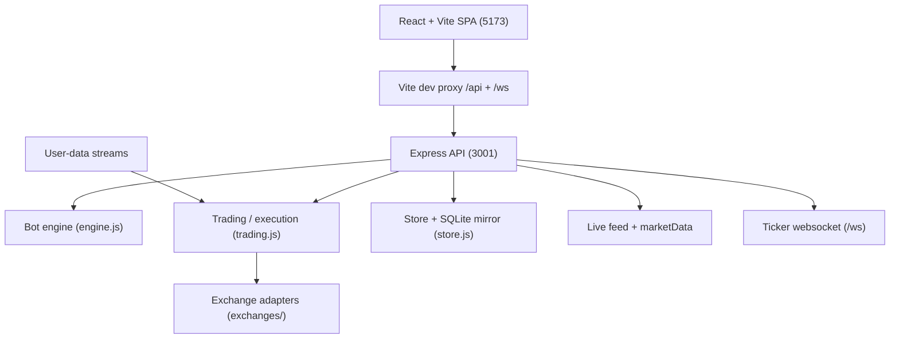

# NebulaTrade

NebulaTrade is a full-stack crypto trading automation platform: a Node.js/Express
backend with real market data, a paper + live execution engine, a bot engine, a
SQLite-backed persistence layer, and a React/Vite dashboard. It ships with a
deterministic offline simulator so the whole product runs without any API keys,
and it upgrades to real venues and real prices as soon as credentials and network
access are available.

- Backend: Node.js (ESM), Express, `ws`, thread-safe-ish in-memory store mirrored
  to SQLite through Node's built-in `node:sqlite`.
- Frontend: React 18 + TypeScript + Vite, React Router, Recharts, lucide-react.
- No third-party SaaS required. LLM strategy and email alerts are opt-in.

## Highlights

- Real market data with best-effort public feeds and automatic fallback to a
  deterministic simulator. The app never fails to boot because a feed is down.
- Real order execution against live exchange adapters, plus a realistic paper
  engine with configurable fees and slippage.
- Five bot strategies (grid, DCA, signal, market-neutral funding capture, AI).
- TradingView-style webhooks and manual signal dispatch.
- Portfolio, equity curve, allocation, positions, orders and PnL analytics.
- Pump screener and multi-timeframe backtester.
- Real TOTP two-factor authentication (RFC 6238), profile management, webhook
  tokens, watchlists and notifications.
- Encrypted-at-rest exchange credentials (AES-256-GCM).

## Feature overview

### Trading and execution

- Paper wallet (100,000 USDT starting balance) for risk-free testing.
- Live trading adapters for Binance, Bybit, OKX plus Iranian spot venues
  Nobitex, Wallex, Tabdeal, Bitpin, OMPFinex and Abantether.
- Market and limit orders, leverage, reduce-only, take-profit, stop-loss and
  trailing stops.
- Exchange-side protective orders where the venue supports them; local
  management for spot venues and for trailing stops.
- Periodic live-account reconciliation (balance + open positions) and real-time
  user-data websockets for Binance (listen key) and Bybit/OKX (authenticated
  websocket login).

### Bots

- Grid, DCA, signal, market-neutral and AI strategies. See
  `docs/USER_GUIDE.md` for each strategy's parameters.

### Analytics

- Dashboard summary, portfolio equity curve, allocation breakdown, PnL and win
  rate, funding rates, and a live ticker tape over websocket.

### Data feeds

- Bulk feeds: Binance, Wallex, Nobitex, OMPFinex.
- Per-symbol fallback: Tabdeal depth (used only for pairs the bulk feeds miss).
- Optional real klines/order book/funding rates; otherwise the simulator.

## Architecture at a glance



The frontend dev server is the single exposed port; it reverse-proxies `/api`
and `/ws` to the backend on port 3001. In production the backend serves the
built frontend from `frontend/dist` on a single port.

## Repository layout

```
start.sh                 Dev launcher (backend 3001 + frontend 5173)
backend/
  src/
    index.js             HTTP + websocket server, schedulers
    engine.js            Bot engine and strategies
    trading.js           Accounts, positions, orders, PnL, live sync
    execution.js         Order-intent construction and fills
    market.js            Simulator, tickers, candles, screener
    marketData.js        Real klines/depth/funding + warm/status
    liveFeed.js          Public ticker sources + fallback
    userStream.js        User-data websocket manager
    store.js             In-memory collections + SQLite persistence
    secret.js            AES-256-GCM credential encryption
    auth.js              Password hashing, JWT, 2FA pending tokens
    totp.js              RFC 6238 TOTP implementation
    aiProvider.js        Optional LLM strategy provider
    mailer.js            Optional SMTP alerts
    exchanges/           Venue adapters and signing helpers
    routes/              auth, market, trading, bots, misc routers
  test/                  node:test suites
  .env.example           Optional integration settings
frontend/
  src/
    pages/               Dashboard, Terminal, Bots, Portfolio, ...
    components/          Layout, UI primitives, live provider
    api.ts               Fetch wrapper with bearer auth
    auth.tsx             Auth context incl. 2FA
    live.tsx             WebSocket ticker context
docs/
  USER_GUIDE.md          How to use every section of the app
  API_REFERENCE.md       HTTP API reference
  ARCHITECTURE.md        Internals and data flow
```

## Quick start

### One command (development)

```bash
./start.sh
```

This starts the backend on port 3001 and the frontend dev server on port 5173
(the exposed entry point), which proxies API and websocket traffic to the backend.

### Manual

```bash
# Terminal 1: backend
cd backend
npm install
PORT=3001 node src/index.js

# Terminal 2: frontend
cd frontend
npm install
npm run dev
```

Open http://localhost:5173, register an account, and a paper wallet plus starter
watchlist are created automatically.

### Production-style single port

```bash
cd frontend && npm run build
cd ../backend && npm start
```

When `frontend/dist` exists the backend serves the SPA and the API together on
port 3001.

## Configuration

All settings are optional environment variables. Copy `backend/.env.example` to
`backend/.env` and fill in your own values. Integrations remain disabled until
configured.

| Variable | Default | Purpose |
| --- | --- | --- |
| `PORT` | `3001` | Backend HTTP port |
| `NT_DATA_DIR` | `backend/data` | Directory for the SQLite DB and key files |
| `NT_LIVE_MARKET` | `1` | Set to `0` to run fully offline on the simulator |
| `NT_FEED_PRIORITY` | `binance,wallex,nobitex,ompfinex` | Preferred feed order |
| `NT_WARM_INTERVAL_MS` | `30000` | Candle warm-up interval |
| `JWT_SECRET` | generated key file | JWT signing key (set in production) |
| `NT_SECRET` | generated key file | Passphrase for credential encryption |
| `NT_PAPER_FEE` | `0.0005` | Paper taker fee |
| `NT_PAPER_SLIPPAGE_BPS` | `2` | Fallback slippage (bps) |
| `NT_SYNC_INTERVAL_MS` | `15000` | Live account reconciliation interval |
| `NT_LLM_API_KEY` | empty | Enables the LLM strategy provider |
| `NT_LLM_BASE_URL` | OpenAI | OpenAI-compatible base URL |
| `NT_LLM_MODEL` | `gpt-4o-mini` | Model name |
| `NT_LLM_TIMEOUT_MS` | `15000` | LLM request timeout |
| `NT_SMTP_HOST` / `PORT` / `SECURE` / `USER` / `PASS` / `FROM` | empty | Email alerts |

Security notes:

- Exchange API keys are encrypted with AES-256-GCM and only the last 4 characters
  are ever returned to the client.
- If `JWT_SECRET` is not set, a persistent random key is generated at
  `backend/data/.jwt.key` instead of a public default. Set it explicitly in
  production.
- The LLM provider and SMTP alerts read credentials only from the environment
  variables above and never hardcode platform keys.

## Paper vs live trading

- `demo`/sandbox accounts (including the Paper Wallet) settle against simulated
  balances. Orders are simulated with fees and slippage from the live book when
  available.
- `live` accounts place real orders using the credentials you provide. A
  connection test runs before the account is saved. Spot-only venues always trade
  the spot market; futures venues reconcile open positions against the exchange.

## Supported exchanges

| Exchange | Region | Markets | Live capable | Verified |
| --- | --- | --- | --- | --- |
| Binance | Global | Spot, Futures | Yes | Yes |
| Bybit | Global | Spot, Futures | Yes | Yes |
| OKX | Global | Spot, Futures | Yes | Yes |
| Nobitex | Iran | Spot | Yes | Yes |
| Wallex | Iran | Spot | Yes | Yes |
| Tabdeal | Iran | Spot | Yes | Yes |
| Bitpin | Iran | Spot | Yes | Beta |
| OMPFinex | Iran | Spot | Yes | Yes |
| Abantether | Iran | Spot | Yes | Beta |
| Bitget, Gate.io, KuCoin, Kraken, Coinbase, MEXC, Hyperliquid | Global | varies | No | - |

"Live capable = No" entries can be connected as demo accounts only; the UI
disables live mode for them.

## Scripts and testing

```bash
# Backend tests (offline, deterministic)
cd backend
npm test

# Frontend type-check + production build
cd frontend
npm run build

# Frontend dev server
npm run dev
```

The backend test suite runs with `NT_LIVE_MARKET=0` against a temporary data
directory and covers the store, market, market data, feeds, exchanges, engine,
execution, auth/2FA, TOTP, user streams, LLM provider, mailer and API flows.

## Documentation

- `docs/USER_GUIDE.md` - how to use every section of the app.
- `docs/API_REFERENCE.md` - HTTP API reference.
- `docs/ARCHITECTURE.md` - internals, data model and data flow.

## Disclaimer

NebulaTrade is a demonstration platform. Trading crypto assets carries risk.
Use API keys with trade permission only and never enable withdrawals. Test with
the paper wallet before connecting a live account.
