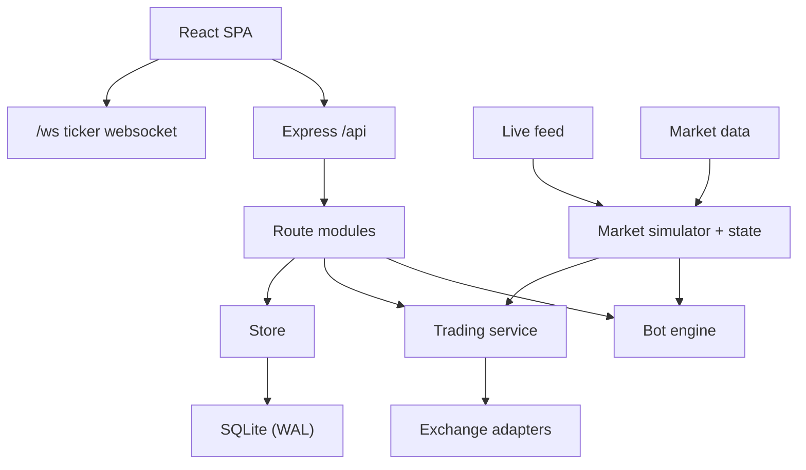

# NebulaTrade Architecture

This document describes how the system is put together, how data flows, and how
to extend it.

## Process model

Two processes in development:

- Backend: `node src/index.js`, HTTP + websocket on port 3001.
- Frontend: `vite`, dev server on port 5173 (the exposed entry point). It proxies
  `/api` to `http://localhost:3001` and `/ws` to `ws://localhost:3001`.

In production a single backend process serves the built SPA from
`frontend/dist` and the API together on port 3001.

## Backend modules

| Module | Responsibility |
| --- | --- |
| `index.js` | Boots Express, mounts routers, runs the ticker websocket, schedules position updates, live sync and candle warm-up |
| `market.js` | Deterministic simulator, in-memory market state, tickers, candles, screener, tick loop |
| `marketData.js` | Real klines/order book/funding with caching plus `warm()` and `status()` |
| `liveFeed.js` | Public ticker sources, priority ordering, bulk + per-symbol fallback |
| `trading.js` | Accounts, positions, orders, PnL, portfolio, live sync, protection |
| `execution.js` | Builds order intents and applies fills |
| `engine.js` | Bot scheduler and strategies, indicators, funding |
| `userStream.js` | User-data websocket manager for Binance/Bybit/OKX |
| `store.js` | In-memory collections mirrored to SQLite |
| `secret.js` | AES-256-GCM credential encryption |
| `auth.js` | Password hashing, JWT signing/verification, 2FA pending tokens |
| `totp.js` | RFC 6238 TOTP |
| `aiProvider.js` | Optional OpenAI-compatible LLM provider |
| `mailer.js` | Optional SMTP alerts |
| `backtest.js` | Historical strategy replay |
| `exchanges/` | Venue adapters, signing helpers, private stream helpers |

Route modules under `routes/`: `auth.js`, `market.js`, `trading.js`, `bots.js`,
`misc.js` (which also exports a public router for the webhook).

## Market data flow

1. `LiveFeed` polls its sources in priority order and merges tickers by pair,
   first source wins. Bulk sources return many pairs at once; per-symbol sources
   (Tabdeal) fill only the pairs still missing.
2. `market.applyLivePrices()` updates the in-memory state (price, change, high,
   low, volume) and marks the pair live.
3. A tick loop emits `tick`, which triggers `updateOpenPositions()` and
   broadcasts tickers over `/ws`.
4. `marketData` supplies real candles, depth and funding, with `warm()` loading
   real history for every pair and bot timeframe shortly after boot and every
   `NT_WARM_INTERVAL_MS`. If a fetch fails the simulator history is used.

If `NT_LIVE_MARKET=0` or every source is unreachable, the app runs entirely on
the deterministic `mulberry32`-based simulator. This is what the test suite uses.

## Execution: paper vs live

`openPosition` / `closePosition` in `trading.js` choose a path based on the
account mode.

Paper / demo:

- Margin and leverage are applied to a simulated balance.
- Fills use the live book when available, otherwise a synthetic ladder, with
  `NT_PAPER_FEE` and `NT_PAPER_SLIPPAGE_BPS`.

Live:

- `executeLive` resolves the adapter and places the order with your credentials.
- Every order is tagged with a client order id so user-stream events can match it.
- Protective orders are placed on the exchange where supported
  (`placeProtection`); trailing stops are always managed locally.
- `syncLiveAccount` reconciles balances and open positions on
  `NT_SYNC_INTERVAL_MS`. Only futures accounts reconcile against the exchange
  position book; spot positions are app-tracked. A spot account never has its
  positions marked exchange-closed.
- User-data websockets update balances and fills in real time:
  - Binance: REST listen key + `userStreamUrl`.
  - Bybit/OKX: authenticated websocket login (`privateStream.js`).

## Bot engine

The engine runs on a timer and, for each running bot, dispatches to a strategy:

| Strategy | Logic summary |
| --- | --- |
| `grid` | Plan levels between lower/upper price, buy dips and sell into strength, one lot per level |
| `dca` | Base order plus scaled safety orders on deviations, exit on take profit or stop loss |
| `signal` | Execute signals created by webhooks or manual dispatch |
| `market_neutral` | Delta-neutral hedged legs capturing funding |
| `ai` | EMA trend + momentum with optional LLM overlay when `NT_LLM_*` is set |

The engine computes indicators (`ema`, `rsi`, `sma`), funding rates and tracks
per-bot stats (`pnl`, `trades`, `winRate`, `openPositions`). Every action is
written to the `logs` collection for auditing.

## Persistence

`store.js` keeps all collections in memory (for the synchronous read API used
throughout the app) and mirrors writes to SQLite immediately. The database lives
at `NT_DATA_DIR/nebulatrade.db` with WAL mode. Node's built-in `node:sqlite`
(`DatabaseSync`) is used, so there is no native dependency.

- Collections: `users, exchanges, bots, orders, positions, logs, notifications,
  watchlist, strategies, signals`.
- High-churn collections have retention caps; open positions are always kept and
  only closed position history is trimmed.
- A legacy `nebulatrade.json` is migrated on first boot if present.

Sensitive values:

- Exchange API secrets and TOTP secrets are encrypted with AES-256-GCM
  (`secret.js`). The key comes from `NT_SECRET` or a generated
  `data/.secret.key`.
- JWTs are signed with `JWT_SECRET` or a generated `data/.jwt.key`.

## Authentication and 2FA

1. Register/login returns a JWT (7 day TTL) stored by the SPA and sent as a
   bearer token.
2. If the user has TOTP enabled, login returns a short-lived (5 minute)
   `pendingToken` scoped to `purpose: 2fa`; the second step exchanges it plus a
   valid code for a real token.
3. Setup stores a pending secret; enabling verifies a code and promotes it;
   disabling requires the password and a current code.
4. TOTP verification accepts one step of clock drift in each direction and
   validates using constant-time comparison.

## Optional integrations

- LLM: when `NT_LLM_API_KEY` (and optionally base URL/model) is set,
  `aiProvider.js` calls an OpenAI-compatible chat completions endpoint; the AI
  strategy falls back to rules on any error. The bot configuration exposes a
  "Use LLM strategy" toggle.
- SMTP: when `NT_SMTP_*` is set, `mailer.js` sends alerts on significant events.
  Both integrations are disabled by default and never crash the app on failure.

## Frontend

- Routing: public routes (`/`, `/login`, `/register`) and an authenticated
  `/app` branch with a guard. Unknown paths redirect to `/`.
- `auth.tsx`: token storage, session bootstrap via `/auth/me`, login including
  the 2FA second step.
- `live.tsx`: a WebSocket context with an auto-reconnecting connection to `/ws`,
  exposing a ticker list and `priceOf(symbol)` for live marks.
- `api.ts`: fetch wrapper that injects the bearer token and normalizes errors.
- Data hooks: `useAsync(fn, deps, { pollMs })` fetches once and optionally polls
  in the background without loading flicker. Live pages poll positions, orders,
  portfolio and bots on short intervals.
- UI primitives in `components/ui.tsx`: loader, modal, toasts, badges, charts.

## Testing

- Backend: `node --test` suites under `backend/test` cover the store, market,
  market data, feeds, exchanges, execution, engine, auth/2FA, TOTP, user
  streams, private streams, indicators, backtest, LLM provider, mailer and a
  full API smoke flow. Tests run offline with `NT_LIVE_MARKET=0`.
- Frontend: `tsc -b` type-check plus a production Vite build.

## Extending the platform

### Add an exchange adapter

Create `exchanges/<id>.js` exporting an object with:

- `id`, `name`, `supports: { spot, futures }`, `requiresSecret`,
  `requiresPassphrase`, `verified`, `exSymbol(pair, marketType)`.
- `testConnection`, `getBalance`, `getPrice`, `setLeverage`, `placeOrder`,
  `cancelOrder`, `getPositions`.
- Optional: `placeProtection` for exchange-side TP/SL, and
  `createListenKey`/`keepAliveListenKey` for a Binance-style user stream.

Register it in `exchanges/index.js` (which also drives `liveCapable` in the
exchanges API) and add it to `SUPPORTED_EXCHANGES` in `routes/trading.js`.

### Add a bot strategy

Add the id to `BOT_TYPES` and metadata to `BOT_TYPE_META`, implement the runner
method, and wire it into the dispatch switch in `engine.js`. Add a default
config in `routes/bots.js` `DEFAULT_CONFIG`.

### Add a market data feed source

Add an entry to `SOURCES` in `liveFeed.js` (bulk `url` + `parse`, or
`perSymbol: true` with a `url(symbol)` factory and `parse`).
